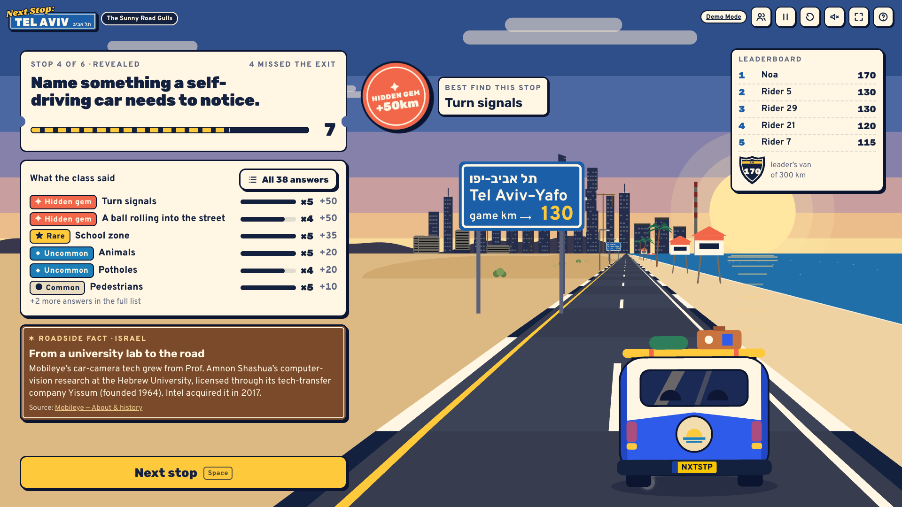

# Next Stop: Tel Aviv 🚐

**The rarer your answer, the further you go.**

A live "name something" road-trip game for the TAMID Fall 2026 Israel Connection Creative Project (Group 3). The class joins from their phones and answers six everyday prompts. Less obvious answers earn more distance toward Tel Aviv, and the farthest traveller wins. The finale answers the assignment question: *Why is the Israeli startup ecosystem so effective?*



---

## Run it

Requires **Node.js 20 or newer**. The first install needs internet.

```bash
cd next-stop-tel-aviv
npm run play
```

`npm run play` installs dependencies if they're missing, builds the app, and starts the server on port 3000. If 3000 is busy, it uses the next free port. It then prints the addresses:

| Screen | URL | What it's for |
| --- | --- | --- |
| Home | `http://localhost:3000/` | Pick a mode, or enter a room code |
| **Host** (projector) | `http://localhost:3000/host` | Creates a room and shows the QR code and four-letter code |
| Join (phones) | `http://<your-LAN-IP>:3000/join?code=ABCD` | The QR code links here |
| Solo | `http://localhost:3000/play` | Play all six rounds yourself, with no room needed |
| **Demo** (fallback) | `http://localhost:3000/demo` | 25 simulated passengers that run entirely in the browser |

Pick a port yourself with `PORT=4000 npm run play`. The offline cache belongs to one exact address (for example `localhost:3001`), so present from the same address you cached.

### Phones: local network vs. public URL

- **Same Wi-Fi (local).** Phones must be on the same network as the laptop. The host screen's QR code automatically uses the laptop's LAN address (for example `http://10.0.0.14:3000/join`). Campus Wi-Fi often blocks device-to-device traffic. If phones can't load the page, use a phone hotspot or a public URL.
- **Public URL (works across networks).** Deploy to Render (below). The QR code then uses the public `https://` address, so phones on cellular data work too.

### Presentation fallback (Demo Mode, offline)

1. While online and the server is running, open `/demo` in **Chrome, Edge or Safari** on `localhost` or an `https` URL.
2. Wait for the **Offline ready ✓** chip in the top bar. It only appears after the service worker confirms every file is cached.
3. Later, `/demo` (and `/play`) will reload and run with **no internet and no server**.

The first visit must happen beforehand: a browser that has never loaded the app has nothing cached. Service workers don't run on plain `http://<LAN-IP>` addresses, so do this step on the presenting laptop at `localhost`. Demo scores are simulated and are labelled that way on screen.

---

## How to play

1. The host opens `/host` on the projector. Players scan the QR code or type the four-letter code.
2. The host picks a game length (3, 4, 4½ or 5 min) and presses **Start the trip** (Space).
3. Each round, everyone gets the same prompt (for example, *Name something that uses a lot of water*) and types **one** answer. The first accepted answer locks in. If the game doesn't recognise an answer, the player can retry until time runs out. **Need an idea?** shows a few common answers.
4. When the round closes, the game reveals rarity, the van surges forward, the class's answers are tallied, and a one-line "roadside fact" about Israel appears.
5. After six rounds the finale shows the podium, then five "exit signs" answering the TAMID question, the competencies, and the crew.

| Rarity | Distance |
| --- | --- |
| ● Common | +10 km |
| ◆ Uncommon | +20 km |
| ★ Rare | +35 km |
| ✦ Hidden gem | +50 km |

Rarity is a **designer-assigned ranking** of how obvious an answer feels. It is not survey data and not based on what the room picks. If several people give the same answer, each still gets its full award. Six hidden gems reach the 300 km destination, but you don't need 300 to win. Ties are broken by total distance, then the number of accepted answers, then the lowest total answer time. Distances are game points, not geography.

### Host controls

| Key | Action |
| --- | --- |
| Space | Start → reveal now → next stop → next finale panel |
| P | Pause / resume |
| R | Restart (asks first; keeps players, clears scores, reopens joining) |
| ? | Shortcut help |

The top bar also has passengers (remove a player), pause, restart, sound (off by default), fullscreen and help. Shortcuts are ignored while you're typing or have a dialog open. Answer and reveal timers advance on their own. Manual skips and pauses change the real running time.

---

## Editing content and timers

| What | Where |
| --- | --- |
| Prompts, accepted answers, aliases, rarity, roadside facts, finale factors, competencies, sources, team roles | [`content/game-content.ts`](content/game-content.ts) |
| Timers and game-length presets, the player cap (60), grace periods | [`content/timing.ts`](content/timing.ts) |

- Matching already ignores case, accents, punctuation, a leading "a/an/the/my", and simple plurals. It also forgives small typos (one in 5–8 letters, two in 9+, with the same first letter, and only when exactly one answer is that close). Add aliases only for real synonyms.
- After editing, run `npm test`. It fails if an alias points at two answers, a round has fewer than 30 answers, or a fact lacks a source URL.
- To rename the crew, edit `TEAM_ROLES` in the content file.

Default timing (`4min`): 20 s lobby allowance + 6 × (25 s answering + 10 s reveal) + 10 s finale allowance = **4:00**. The other presets are 3:00, 4:30 and 5:00. The host starts the game by hand, and the finale stays on screen until restarted.

---

## Project layout

```
content/   game-content.ts (the one content file) · timing.ts
shared/    types, answer matcher, game engine (state machine), bots, socket protocol
server/    Express + Socket.IO rooms, sessions, reconnects
client/    React UI · src/scene/renderer.ts (the canvas road trip) · public/sw.js (offline cache)
tests/     content, matcher, engine, live 40-client server tests
docs/      research page, host script, rehearsal checklist, screenshots
scripts/   play, dev, offline check, screenshot tour
```

One engine (`shared/engine.ts`) runs every mode. The server uses it authoritatively for live rooms, and the browser uses it directly for Solo and Demo.

### Reliability notes

- **Server-authoritative.** The server checks scoring, deadlines, duplicate/stale/late submissions, and the "join only before the first prompt" rule. Rarity and other players' answers are hidden until the reveal.
- **Sessions.** Hosts and players get random tokens stored in `localStorage`, so a refresh or reconnect restores the same seat or host screen. Only the host token can run host controls.
- **Host disconnect** pauses the room. When the host reconnects, the room stays paused until the host presses Resume.
- **Solo and Demo** save to `localStorage`. A refresh restores the trip, paused until you resume.
- **Memory only.** Rooms live in one server process's memory. Restarting or redeploying the server ends all live rooms, and phones will show "session expired". Run **one** instance.

---

## Scripts

| Command | What it does |
| --- | --- |
| `npm run play` | Install if needed → build → start (production) |
| `npm run dev` | Server on :3000 + Vite dev server on :5173 with hot reload |
| `npm run typecheck` | TypeScript, no emit |
| `npm test` | All tests, including a full six-round game with 40 live Socket.IO clients |
| `npm run check` | Typecheck + tests + production build |
| `node scripts/verify-offline.mjs` | After a build: loads `/demo` in headless Chrome, stops the server, reloads and plays offline |
| `node scripts/screenshots.mjs [dir]` | After a build: plays a live game with real phone pages and 37 bots, saving every screen |

The last two need Google Chrome (or set `CHROME_PATH`).

---

## Deploy (Render)

1. Push this folder to a GitHub repository.
2. In Render: **New → Blueprint**, then pick the repo. `render.yaml` creates one web service with build `npm ci --include=dev && npm run build`, start `npm start` and health check `/healthz`.
3. Open `https://<your-service>.onrender.com/host`. The QR code uses the public URL automatically (Render sets `RENDER_EXTERNAL_URL`; you can also set `PUBLIC_URL`).
4. **Free plans sleep** when idle. Open the URL a few minutes before presenting so it's awake, and don't redeploy during class.

Any Node host that supports WebSockets works (Railway, Fly.io, a VPS) with `npm run build` and `npm start`. Keep it to a single instance.

---

## Troubleshooting

| Symptom | Fix |
| --- | --- |
| Phones can't open the join page | Same Wi-Fi? Campus networks often isolate devices. Use a hotspot or the Render URL. Check the laptop firewall allows Node on port 3000. |
| "Can't reach the server" on `/host` | The server isn't running. Run `npm run play`, or switch to `/demo`. |
| "This session has expired" | The server restarted. Phones join again with the new code. |
| No "Offline ready" chip | Use Chrome, Edge or Safari on `localhost` or https (not a LAN IP), load `/demo` once online, and wait a few seconds. Some embedded browsers block service workers; the chip then says so. |
| "Someone already called shotgun on that name" | Nicknames are unique per room. |
| Need to remove a player | Host → passengers icon → Remove → Confirm. |
| Port already in use | `PORT=4000 npm run play` |

---

## Team ownership (Group 3)

| Role | Owner | Owns |
| --- | --- | --- |
| Research & content | Charlie | Fact-checking, sources, answer bank (`content/`, `docs/background-research.md`) |
| Game logic | Hudson | Rules, scoring, multiplayer (`shared/`, `server/`, `tests/`) |
| Visual design | Carter | Journey scene, branding (`client/`) |
| Narration & presentation | Sienna | Host script and live hosting (`docs/host-script.md`) |

These name-to-role pairings are placeholders. Swap them in `TEAM_ROLES` (`content/game-content.ts`) and here.

## Credits

All artwork is original and drawn in code. Fonts are Rubik, Overpass and Shrikhand (SIL Open Font License), bundled locally through Fontsource. Inspired by the "name something, rarer is better" feel of krillion.io; no assets were copied. There is no TAMID logo.

## Verification status

- ✅ Verified locally: production build, TypeScript, unit and integration tests (including a 40-client six-round game), the offline Demo reload with the server stopped (headless Chrome), and screenshots at 1920×1080 and 375×667.
- ✅ Live on Render at https://next-stop-tel-aviv.onrender.com: a scripted round with 12 remote WebSocket clients scored correctly, reconnect worked, and the host QR code uses the public URL.
- ⚠️ Not verified: real physical phones (iOS/Android). See `docs/rehearsal-checklist.md`.
